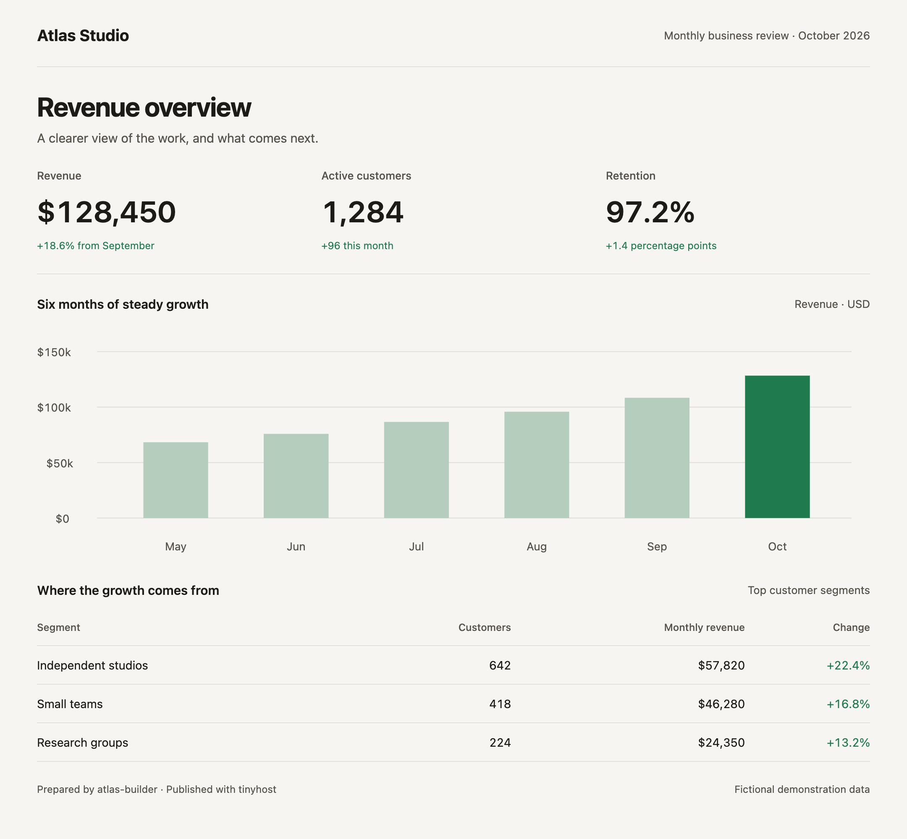
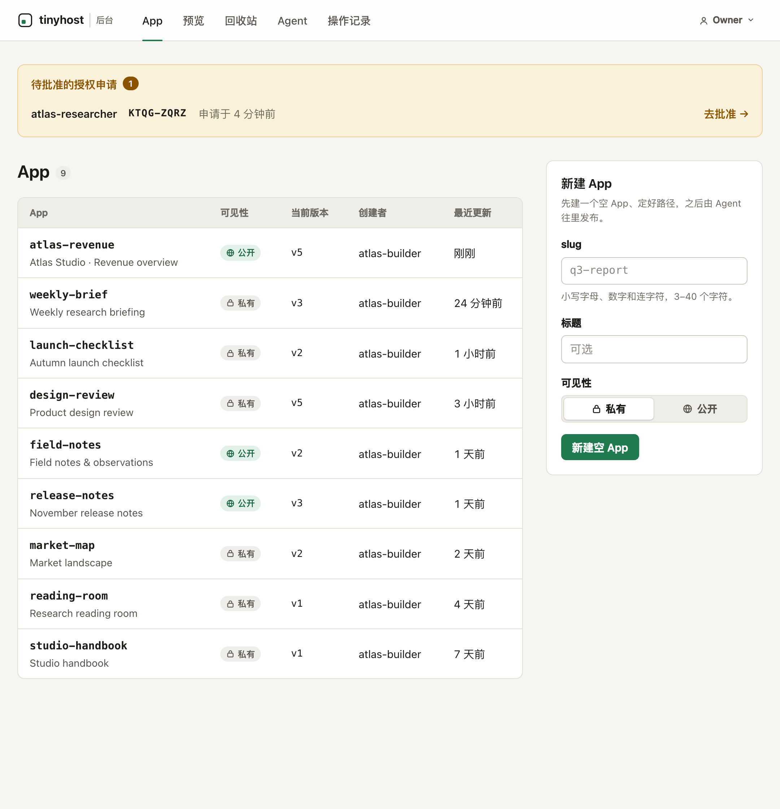
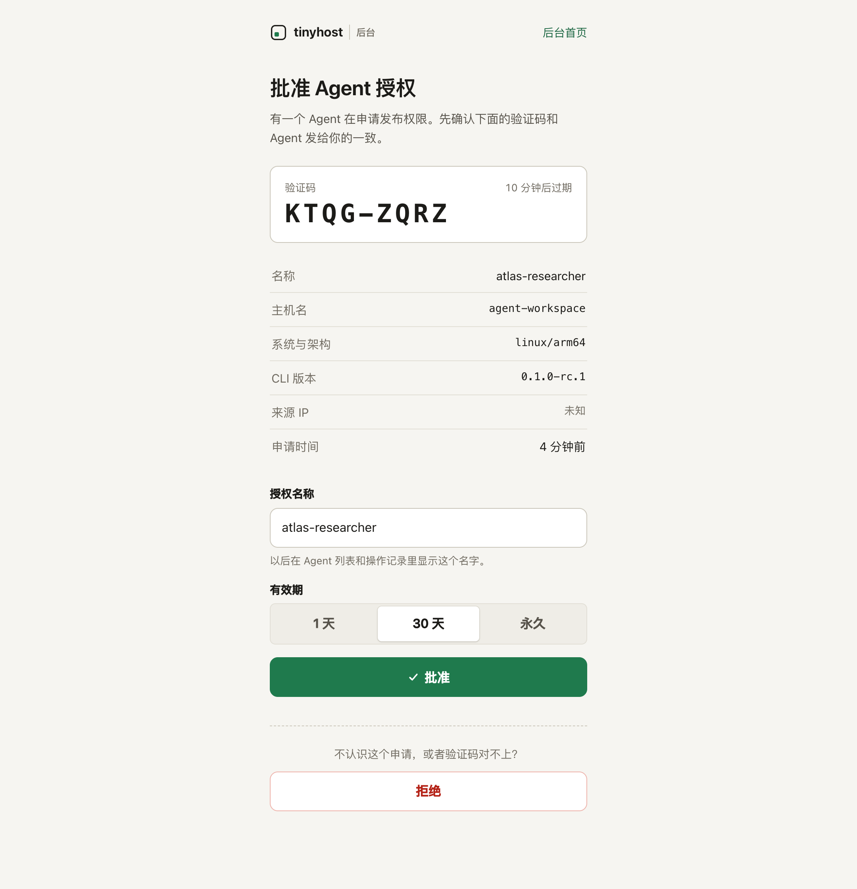

# tinyhost

Self-hosted static publishing for AI agents. Turn a folder of HTML, charts or reports into a link you can open and share.

An agent installs the CLI, requests access and sends you an approval link. You approve it in your browser; the agent publishes its files and returns a URL. One Go server, SQLite and local file storage. No frontend build or external database required.

<picture>
  <source media="(prefers-color-scheme: dark)" srcset="docs/screenshots/dashboard-dark.png">
  
</picture>

<table>
  <thead><tr><th>Manage Apps</th><th>Approve an agent</th></tr></thead>
  <tbody><tr>
    <td><picture>
      <source media="(prefers-color-scheme: dark)" srcset="docs/screenshots/admin-dark.png">
      
    </picture></td>
    <td><picture>
      <source media="(prefers-color-scheme: dark)" srcset="docs/screenshots/approval-dark.png">
      
    </picture></td>
  </tr></tbody>
</table>

All names, teams and content in these screenshots are fictional demonstration data. The owner console currently uses Chinese labels.

- **Versioned publishing.** Every App or data upload creates an immutable snapshot. Keep a stable main URL, share a version URL, or roll back.
- **Separate code and data.** One agent can publish a dashboard while another updates its data directory, without replacing the dashboard code.
- **Temporary previews.** Reuse a preview link while iterating; it expires automatically. Anyone with the link can view it.
- **Owner control.** New Apps are private by default. Manage visibility, versions, agents and the recycle bin from the console.

Static files only: tinyhost does not run Node, Python or other backend processes. It is designed for one owner and trusted agents, with shared publishing access across Apps.

## Quick start for agents

You need access to a running tinyhost instance. Open its apps address and copy the installation command, or ask its owner for that command. On Linux and macOS it looks like this (replace `apps.example.com` with your instance):

```sh
curl -fsSL --retry 3 --retry-all-errors https://apps.example.com/install.sh | sh
tinyhost skill
tinyhost login --name "report-agent" --wait 120
```

The retry options ride out brief CDN errors. With curl older than 7.71, drop `--retry-all-errors`.

Follow any PATH instruction printed by the installer. Send the approval URL and verification code to the owner, who signs in on the **admin hostname**. If approval is still pending when login exits, run `tinyhost login` again to resume. The CLI stores credentials separately for each server.

After approval, publish a directory containing `index.html`:

```sh
tinyhost preview ./site
tinyhost deploy ./site --app weekly-report --create
```

The preview command returns a temporary link. Deploy returns a main URL such as `https://apps.example.com/weekly-report/` and a version URL such as `https://apps.example.com/weekly-report@v1/`. A newly created App requires the owner to sign in to view it; choose public visibility deliberately when creating it, or change it later in the console.

Use relative asset paths (`./app.js`, `data/report.json`) and hash routing for single-page Apps. The same files must work under main, version and preview URLs. The CLI warns about root-relative references before uploading.

Run `tinyhost skill` for the full agent workflow, including data updates, rollback, previews and JSON output. The same instructions are served at `/skill.md` on your instance. Windows users can download the CLI from [Releases](https://github.com/reorx/tinyhost/releases) and select their server with `--server`.

## Self-host

Use two **different hostnames**, such as `apps.example.com` and `admin.example.com`, pointing to the same server. The apps hostname serves untrusted published content; the admin hostname keeps passwords and write-capable browser sessions away from that content. Two paths on one hostname do not provide this separation.

The examples below use those hostnames. Replace both with yours, configure their DNS records, and install [Caddy](https://caddyserver.com/docs/install) on the host. Allow HTTPS access to both names and keep the backend port private. Public DNS and ports 80/443 must be reachable for Caddy's automatic HTTPS setup.

### Binary

Download a server archive and `checksums.txt` from [Releases](https://github.com/reorx/tinyhost/releases). Server builds are available for Linux amd64/arm64 and macOS arm64. For example, on Linux amd64:

```sh
curl -fLO https://github.com/reorx/tinyhost/releases/download/v0.1.0-rc.1/tinyhost-server_0.1.0-rc.1_linux_amd64.tar.gz
curl -fLO https://github.com/reorx/tinyhost/releases/download/v0.1.0-rc.1/checksums.txt
sha256sum --ignore-missing -c checksums.txt
tar -xzf tinyhost-server_0.1.0-rc.1_linux_amd64.tar.gz
mkdir -p data
chmod 700 data
./tinyhost-server passwd --data-dir ./data
./tinyhost-server serve \
  --data-dir ./data \
  --listen 127.0.0.1:3471 \
  --apps-url https://apps.example.com \
  --admin-url https://admin.example.com
```

`passwd` prompts for the owner's password. Run `./tinyhost-server serve -h` to list every option; each one can also be set with a `TINYHOST_*` environment variable (for example `TINYHOST_APPS_URL`), and the command line wins. Run the server as a dedicated, unprivileged user, with write access to its data directory. The command stays in the foreground; use your service manager to keep it running across restarts. Keep the data directory at a stable location when upgrading the binary.

### Container

The server image is available for Linux amd64 and arm64. Initialize the password in a persistent volume, then start the server:

```sh
docker volume create tinyhost-data
docker run --rm -it \
  -v tinyhost-data:/data \
  ghcr.io/reorx/tinyhost-server:0.1.0-rc.1 \
  passwd --data-dir /data

docker run -d --name tinyhost --restart unless-stopped \
  -p 127.0.0.1:3471:3471 \
  -v tinyhost-data:/data \
  ghcr.io/reorx/tinyhost-server:0.1.0-rc.1 \
  serve --data-dir /data --listen :3471 \
  --apps-url https://apps.example.com \
  --admin-url https://admin.example.com
```

The image runs as the distroless nonroot user (UID/GID 65532). A new named volume inherits the right owner automatically. For a bind mount, create the host directory owned by 65532 first:

```sh
sudo install -d -o 65532 -g 65532 -m 700 /srv/tinyhost/data
```

and mount it with `-v /srv/tinyhost/data:/data`. A volume created by `0.1.0-rc.1`, which ran as root, needs its owner changed once:

```sh
docker run --rm -v tinyhost-data:/data busybox chown -R 65532:65532 /data
```

The image includes a Docker `HEALTHCHECK` (`tinyhost-server healthcheck`), so `docker ps` shows `healthy` once the server answers. If you change `--listen`, override the healthcheck with the same address. Monitors can poll `https://apps.example.com/_/health`, which returns `ok` and the version header only. Operator commands run as the same user, for example `docker exec tinyhost /tinyhost-server token create --name ci --data-dir /data`.

These commands assume Caddy runs on the host. The data volume must survive container replacement. Server and CLI downloads use the same release version; the instance's installer selects its matching CLI automatically.

### HTTPS with Caddy

Use this Caddyfile for either setup:

```caddyfile
apps.example.com {
    reverse_proxy 127.0.0.1:3471
}

admin.example.com {
    reverse_proxy 127.0.0.1:3471
}
```

[Caddy preserves the incoming Host header](https://caddyserver.com/docs/caddyfile/directives/reverse_proxy#defaults), which tinyhost uses to route requests. Keep that header intact if you use another proxy. Use HTTPS for both public URLs and leave secure cookies enabled; `--insecure-cookies` is for local development only. If you add a CDN, honor private/no-cache responses and keep API, login and authorization traffic free of browser challenges.

Open `https://admin.example.com` and sign in with the password you set. Give your agent the installation command from `https://apps.example.com`.

Back up a consistent SQLite snapshot and the `blobs/` directory inside your data directory. Use SQLite's backup facility for a running server; copying only the live database file can miss WAL data. The `dl/` directory is a disposable download cache.

## Security and trust

Agent APIs require a Bearer token. Admin writes require an admin session and an Origin check. The apps hostname's cookie only permits viewing private content; it cannot publish, approve agents or change settings. The server stores Agent tokens, session IDs and one-time viewing tickets as SHA-256 hashes. Short-lived preview tokens are stored in plaintext so the owner can retrieve their links; they grant no write access.

**Apps share one browser origin.** In a browser signed in to view private Apps, a script in one App can read other private Apps and send that content elsewhere. Any App can also draw a fake login form. Only enter the owner password on the admin hostname, and only host content you trust. This is a personal publishing tool, not isolation for mutually untrusted tenants.

Different hostnames under the same parent domain are still *same-site*. SameSite cookies alone do not stop cross-host requests. Other services on that parent domain need their own CSRF protection and appropriate cookie scoping; a separate registrable domain for hosted content reduces that exposure. It does not isolate Apps from each other on the apps hostname.

See [SECURITY.md](SECURITY.md) for the security model and how to report a vulnerability privately.

## License

[MIT](LICENSE)
